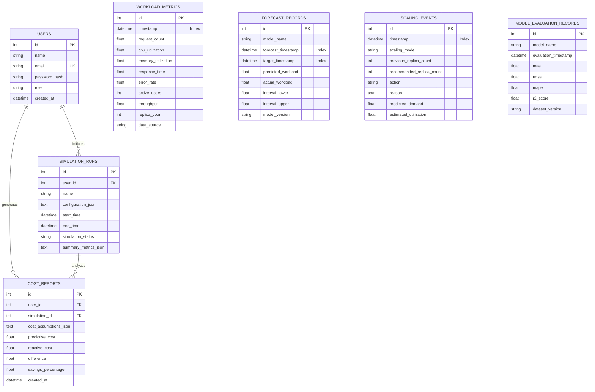

# Database Design Document
## AI-Based Predictive Autoscaling Engine: Machine Learning-Driven Workload Forecasting, Intelligent Resource Allocation, and Cloud Cost Optimization

**Document Version:** 1.0.0  
**Database Engine:** SQLite 3 (Default local zero-config ORM) / Compatible with PostgreSQL  
**Object-Relational Mapping (ORM):** Flask-SQLAlchemy 3.1+ / SQLAlchemy 2.0+  

---

### 1. Database Architecture & ER Diagram

---

### 2. Table Specifications & Schemas

#### 2.1 `users`
Stores user identities, credentials, and roles for Role-Based Access Control (RBAC).

| Column Name | Data Type | Constraints | Description |
|---|---|---|---|
| `id` | `INTEGER` | PRIMARY KEY, AUTOINCREMENT | Unique user identifier |
| `name` | `VARCHAR(100)` | NOT NULL | User's full display name |
| `email` | `VARCHAR(120)` | UNIQUE, NOT NULL, INDEX | Login email address |
| `password_hash`| `VARCHAR(255)` | NOT NULL | Salted PBKDF2/SHA256 password hash |
| `role` | `VARCHAR(20)` | NOT NULL, DEFAULT 'user' | Access level: `'user'` or `'admin'` |
| `created_at` | `DATETIME` | DEFAULT CURRENT_TIMESTAMP | Account creation timestamp |

#### 2.2 `workload_metrics`
Stores raw hourly telemetry logs (either synthetically generated or user uploaded).

| Column Name | Data Type | Constraints | Description |
|---|---|---|---|
| `id` | `INTEGER` | PRIMARY KEY, AUTOINCREMENT | Unique metric record ID |
| `timestamp` | `DATETIME` | NOT NULL, INDEX | Observation timestamp |
| `request_count` | `FLOAT` | NOT NULL | Incoming requests per second |
| `cpu_utilization`| `FLOAT` | NOT NULL | Average CPU utilization percentage (0-100) |
| `memory_utilization`| `FLOAT` | NOT NULL | Average memory utilization percentage (0-100) |
| `response_time` | `FLOAT` | NOT NULL | Average request latency (milliseconds) |
| `error_rate` | `FLOAT` | DEFAULT 0.0 | Request error rate percentage |
| `active_users` | `INTEGER` | DEFAULT 0 | Estimated concurrent user sessions |
| `throughput` | `FLOAT` | DEFAULT 0.0 | Network egress throughput (MB/s) |
| `replica_count`| `INTEGER` | DEFAULT 2 | Active server instance replicas |
| `data_source` | `VARCHAR(50)` | DEFAULT 'synthetic' | Origin: `'synthetic'`, `'uploaded'`, `'live'` |

#### 2.3 `forecast_records`
Maintains historical forecasts generated by the Random Forest model and empirical intervals.

| Column Name | Data Type | Constraints | Description |
|---|---|---|---|
| `id` | `INTEGER` | PRIMARY KEY, AUTOINCREMENT | Unique forecast ID |
| `model_name` | `VARCHAR(100)` | NOT NULL | Name of model (e.g. `'RandomForestRegressor'`) |
| `forecast_timestamp`| `DATETIME` | INDEX, DEFAULT CURRENT_TIMESTAMP | When inference was performed |
| `target_timestamp`| `DATETIME` | NOT NULL, INDEX | Future time target being forecasted |
| `predicted_workload`| `FLOAT` | NOT NULL | Forecasted request volume (req/s) |
| `actual_workload`| `FLOAT` | NULLABLE | Actual observed demand (filled retrospectively) |
| `interval_lower`| `FLOAT` | NULLABLE | 5th percentile empirical lower bound |
| `interval_upper`| `FLOAT` | NULLABLE | 95th percentile empirical upper bound |
| `model_version`| `VARCHAR(50)` | DEFAULT 'v1.0' | Model version identifier |

#### 2.4 `scaling_events`
Audit trail of every scaling action taken by the decision engine with mathematical rationale.

| Column Name | Data Type | Constraints | Description |
|---|---|---|---|
| `id` | `INTEGER` | PRIMARY KEY, AUTOINCREMENT | Event identifier |
| `timestamp` | `DATETIME` | INDEX, DEFAULT CURRENT_TIMESTAMP | Event occurrence time |
| `scaling_mode` | `VARCHAR(50)` | NOT NULL | Scaling strategy: `'predictive'` or `'reactive'` |
| `previous_replica_count`| `INTEGER` | NOT NULL | Replicas before decision |
| `recommended_replica_count`| `INTEGER`| NOT NULL | Recommended replica count |
| `action` | `VARCHAR(20)` | NOT NULL | `'SCALE_UP'`, `'SCALE_DOWN'`, `'MAINTAIN'` |
| `reason` | `TEXT` | NOT NULL | Transparent human-readable explanation |
| `predicted_demand`| `FLOAT` | NULLABLE | Incoming workload value triggering decision |
| `estimated_utilization`| `FLOAT`| NULLABLE | Expected CPU utilization post-scaling (%) |

#### 2.5 `simulation_runs`
Stores completed simulation runs for persistent comparison and report generation.

| Column Name | Data Type | Constraints | Description |
|---|---|---|---|
| `id` | `INTEGER` | PRIMARY KEY, AUTOINCREMENT | Simulation run identifier |
| `user_id` | `INTEGER` | FOREIGN KEY (`users.id`) | User who executed the simulation |
| `name` | `VARCHAR(100)`| DEFAULT 'Workload Simulation' | Session label |
| `configuration_json`| `TEXT` | NOT NULL | JSON string of simulation parameters |
| `start_time` | `DATETIME` | DEFAULT CURRENT_TIMESTAMP | Simulation start timestamp |
| `end_time` | `DATETIME` | NULLABLE | Simulation completion timestamp |
| `simulation_status`| `VARCHAR(50)` | DEFAULT 'completed' | Status: `'running'`, `'paused'`, `'completed'` |
| `summary_metrics_json`| `TEXT` | NULLABLE | Serialized comparison scorecard JSON |

#### 2.6 `cost_reports`
Financial summaries comparing predictive vs. reactive vs. static expenditures.

| Column Name | Data Type | Constraints | Description |
|---|---|---|---|
| `id` | `INTEGER` | PRIMARY KEY, AUTOINCREMENT | Cost report ID |
| `user_id` | `INTEGER` | FOREIGN KEY (`users.id`) | Author user ID |
| `simulation_id`| `INTEGER` | FOREIGN KEY (`simulation_runs.id`)| Associated simulation ID |
| `cost_assumptions_json`| `TEXT` | NOT NULL | Unit costs, duration, instance bounds |
| `predictive_cost`| `FLOAT` | NOT NULL | Cost under predictive scaling ($) |
| `reactive_cost`| `FLOAT` | NOT NULL | Cost under reactive scaling ($) |
| `difference` | `FLOAT` | NOT NULL | Net dollar savings ($) |
| `savings_percentage`| `FLOAT` | NOT NULL | Percentage budget reduction (%) |
| `created_at` | `DATETIME` | DEFAULT CURRENT_TIMESTAMP | Generation timestamp |

#### 2.7 `model_evaluation_records`
Records model accuracy metrics across retraining cycles.

| Column Name | Data Type | Constraints | Description |
|---|---|---|---|
| `id` | `INTEGER` | PRIMARY KEY, AUTOINCREMENT | Metric record ID |
| `model_name` | `VARCHAR(100)` | NOT NULL | Model identifier |
| `evaluation_timestamp`| `DATETIME` | DEFAULT CURRENT_TIMESTAMP | Evaluation timestamp |
| `mae` | `FLOAT` | NOT NULL | Mean Absolute Error (req/s) |
| `rmse` | `FLOAT` | NOT NULL | Root Mean Squared Error (req/s) |
| `mape` | `FLOAT` | NOT NULL | Mean Absolute Percentage Error (%) |
| `r2_score` | `FLOAT` | NULLABLE | Goodness of fit coefficient |
| `dataset_version`| `VARCHAR(50)`| DEFAULT 'synthetic-v1.0' | Dataset tag |

---

### 3. Database Security & Integrity Policies
1. **Password Encryption**: All passwords stored in `users.password_hash` are salted using PBKDF2 with SHA-256 via Werkzeug security utilities. Cleartext passwords are never logged or stored.
2. **Cascading Deletions**: Deleting a user safely cascades to delete their private simulation runs and cost reports.
3. **Database Indexing**: Crucial query columns (`timestamp`, `target_timestamp`, `email`) are explicitly indexed with B-Tree indices to guarantee sub-millisecond lookups.
