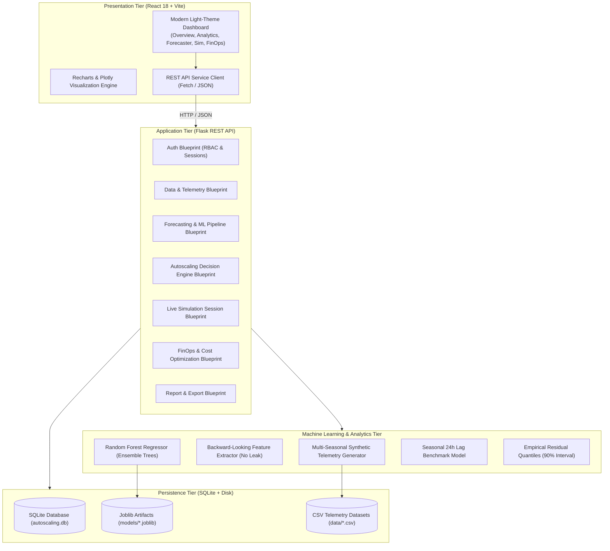
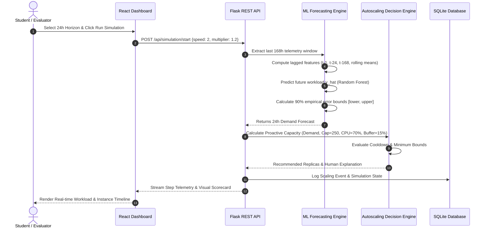
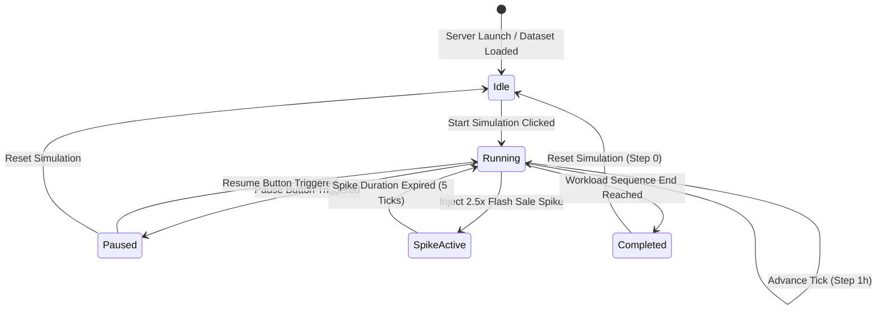

# System Design Document
## AI-Based Predictive Autoscaling Engine: Machine Learning-Driven Workload Forecasting, Intelligent Resource Allocation, and Cloud Cost Optimization

**Document Version:** 1.0.0  
**Target Academic Degree:** B.Tech Computer Science and Engineering  

---

### 1. High-Level System Architecture

The AI-Based Predictive Autoscaling Engine follows a layered decoupled architecture comprising a modern React/Vite single-page application, a Python Flask RESTful backend service layer, an in-memory simulation state manager, an offline/online ML inference pipeline, and an SQLite relational persistence layer.

---

### 2. Machine Learning Inference & Autoscaling Decision Flow

---

### 3. Data Flow Diagram (DFD Level 1)

```mermaid
flowchart LR
    P0["(0) Synthetic Workload Generator"] -->|Raw Time-Series| D1[("workload_data.csv")]
    D1 --> P1["(1) Feature Engineering Pipeline"]
    P1 -->|Lagged Features Matrix| P2["(2) Random Forest Trainer"]
    P2 -->|Trained Weights| D2[("forecast_model.joblib")]
    
    D2 --> P3["(3) Multi-Horizon Forecaster"]
    D1 --> P3
    P3 -->|Forecasted Demand| P4["(4) Proactive Scaling Engine"]
    
    P4 --> P5["(5) Head-to-Head Comparative Simulator"]
    D1 --> P5
    P5 -->|Simulation Metrics| D3[("autoscaling.db")]
    
    D3 --> P6["(6) FinOps Cost Service"]
    P6 -->|Cost Projections & CSV| User["Client Dashboard / Examiner"]
```

---

### 4. Simulation Engine State Machine

---

### 5. Detailed Component Specifications

#### 5.1 Presentation Tier (`frontend/src/`)
- Built with **React 18** and **Vite** with instant Hot Module Replacement (HMR).
- Uses **Tailwind CSS v4** styling following an accessible, clean light design system:
  - Neutral canvas: `#f8fafc` (slate-50).
  - Cards: Crisp white `#ffffff` with subtle borders (`#e2e8f0`) and elevation shadows.
  - Accent colors: Blue-600 (`#2563eb`), Teal-600 (`#0d9488`), Indigo-600 (`#4f46e5`), Emerald-600 (`#16a34a`), Rose-500 (`#f43f5e`).
- Interactive visualization using **Recharts** with dual-axis curves, shaded prediction interval bands, custom tooltips, and responsive containers.
- 12 comprehensive pages covering the full lifecycle from data generation to cost reports and authentication.

#### 5.2 Application Tier (`backend/app/`)
- Organized using the **Flask Application Factory** pattern (`create_app`), modular Blueprints, and clean domain services.
- **REST Blueprints**:
  - `auth_routes.py`: `/api/auth` (User registration, login, logout, profile, and 1-click faculty/student demo logins).
  - `data_routes.py`: `/api/data` (Generation, pagination, summary stats, CSV upload, and CSV export).
  - `forecast_routes.py`: `/api/forecast` (Model training, multi-step predictions, evaluation benchmarks).
  - `autoscaling_routes.py`: `/api/autoscaling` (Single point recommendations, full comparison runner, event logs).
  - `simulation_routes.py`: `/api/simulation` (Real-time live play/pause/step/spike controls).
  - `cost_routes.py`: `/api/cost` (FinOps expenditure projection, savings calculators, CSV exports).
  - `report_routes.py`: `/api/reports` (Executive summary JSON, full simulation comparison CSV).

#### 5.3 Machine Learning Pipeline (`backend/app/ml/`)
- **Synthetic Data Generator (`data_generator.py`)**:
  - Diurnal sinusoidal curve: $350 + 260 \sin\left(\frac{(h-8) 2\pi}{24}\right) + 70 \exp\left(-\frac{(h-20)^2}{8}\right)$.
  - Day of week modulation factors: $[1.08, 1.12, 1.15, 1.10, 1.05, 0.78, 0.82]$.
  - Coupled queuing physics: $U_{\text{cpu}} = \min\left(99.5\%, \frac{\text{requests}}{\text{replicas} \times 250} \times 70\% + \mathcal{N}(0, 3.5)\right)$.
  - Non-linear queuing latency with exponential saturation hockey stick when CPU > 75%.
- **Feature Engineering (`feature_engineering.py`)**:
  - Strictly backward-looking variables to eliminate target leakage.
  - Lags: $t-1, t-2, t-3, t-24, t-168$.
  - Rolling windows: 3h, 6h, 24h backward moving averages and standard deviation.
  - Cyclical encoding: $\sin(2\pi h / 24)$, $\cos(2\pi h / 24)$, $\sin(2\pi d / 7)$, $\cos(2\pi d / 7)$.
- **Forecaster (`forecasting.py`)**:
  - Random Forest ensemble with 100 decision trees, max depth 15.
  - Baseline Seasonal Lag model predicting the load observed 24 hours prior.
  - Chronological split: earliest 80% for training, latest 20% for testing.
  - Error residual quantiles: derivation of 5th and 95th percentiles to form empirical error bands.

#### 5.4 Autoscaling Decision Logic (`backend/app/autoscaling/`)
- **Predictive Autoscaling**:
  $$\text{Target} = \left\lceil \frac{\hat{y}_{t+1}}{\text{Cap} \times (\text{Target CPU}/100)} \times (1 + \text{Buffer}) \right\rceil$$
  Scaled up proactively so instances boot before the surge arrives. Downscaling is throttled by cooldown counters (3 periods) to prevent thrashing.
- **Reactive Autoscaling (Kubernetes HPA baseline)**:
  $$\text{Target} = \left\lceil \text{Current Replicas} \times \left(\frac{\text{Current CPU}}{\text{Target CPU}}\right) \right\rceil$$
  Triggers only after observed CPU breaches 80%. New replicas suffer a 1-step boot delay, leaving existing servers temporarily saturated.
